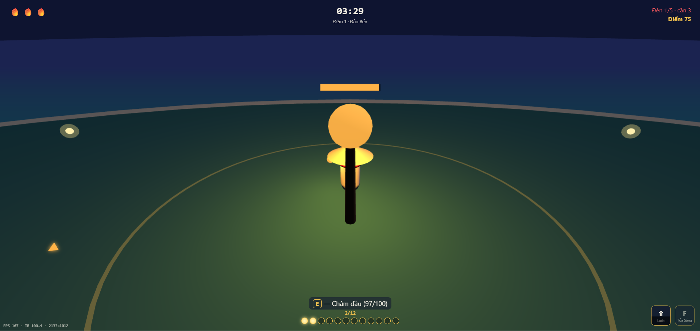
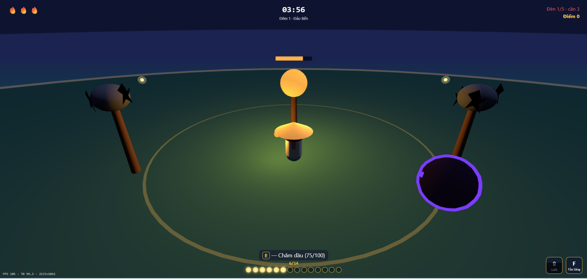
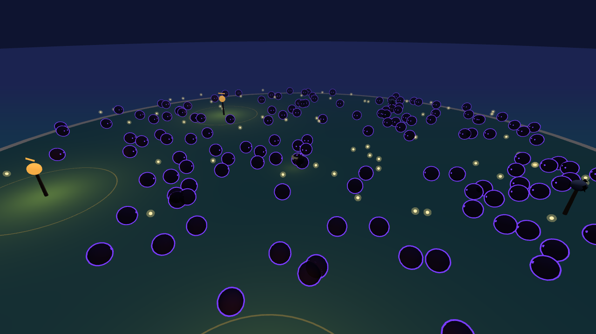
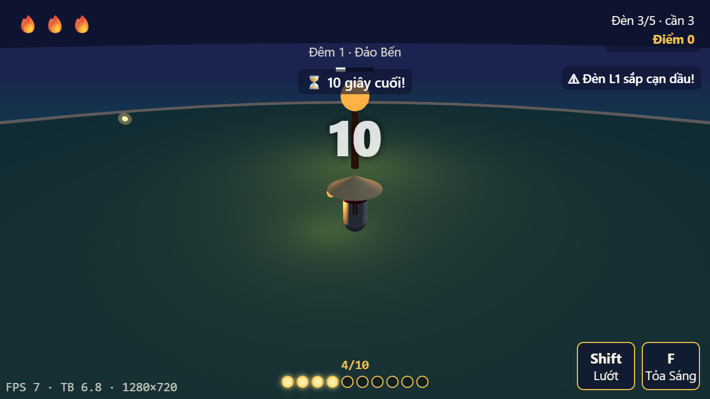

# Đảo Đèn Lồng

> **Video demo:** _(người học cập nhật link Release v1.0.0 / `docs/demo/demo.mp4`)_
> **Bản chạy được:** GitHub Release **v1.0.0** → `dao-den-long-v1.0.0-web.zip` (giải nén, `node server.mjs`).
> Lab Day 12 — AI SDLC · Đề bài: [docs/lab/](docs/lab/README.md) · Ticket hiện hành: [TICKET-04](docs/phases/ticket-04.md) · Test Contract **v1.3**

Game 3D góc nhìn thứ ba chạy trên trình duyệt: Mây, người giữ đèn nhỏ tuổi đội nón lá, gom đom đóm để thắp Đèn Lồng trên ba hòn đảo giữa biển mây, châm dầu giữ cho đủ đèn còn sáng tới bình minh và dùng Tỏa Sáng xua Bóng Mực hút dầu trong sương đen.



| Bóng Mực hút dầu đèn yếu | Cảnh benchmark (200 Bóng Mực) | Phụ đề + chỉ báo, chữ lớn, bảng màu dễ phân biệt |
|---|---|---|
|  |  |  |

## Yêu cầu hệ thống

| | Tối thiểu |
|---|---|
| Hệ điều hành | Windows 10/11, macOS 12+, Linux (x64/arm64) |
| Node.js | **22** trở lên (headless/test chạy được trên 20; bench cần 22 vì dùng `WebSocket` có sẵn) |
| Trình duyệt | Chrome hoặc Edge mới (bench cần một trong hai); chơi được trên Firefox/Safari có WebGL2 |
| GPU | Bất kỳ GPU có WebGL2 (đo trên Intel UHD tích hợp: ~115 FPS ở cảnh bench 1280×720) |
| RAM | 4 GB |

## Cài đặt và chơi (2 lệnh sau khi clone)

```bash
npm ci        # cài three + vite và tự build bản web vào dist/
npm start     # = node server.mjs → mở http://localhost:5173 (Ctrl+C để thoát)
```

`npm run dev` (Vite, tải lại nóng) cũng chơi được. `http://localhost:5173/?night=2` vào thẳng Đêm 2.

## Điều khiển (đổi được trong Cài đặt → Phím)

| Phím mặc định | Hành động |
|---|---|
| W A S D | Di chuyển (theo hướng camera) |
| Kéo chuột trái, ← → | Xoay camera |
| Space | Nhảy |
| Shift | Lướt 14 m/s trong 0.2 s, hồi chiêu 1.5 s |
| E | Đèn gần nhất trong 2 m: nạp đom đóm để thắp (10, thắp lại 5) hoặc châm dầu đèn đang sáng |
| F | Tỏa Sáng: tốn 3 đom đóm, làm choáng + đẩy Bóng Mực trong 5 m, hồi chiêu 3 s |
| P / Esc | Tạm dừng (Esc luôn mở menu, không gán lại được) |

**Dễ tiếp cận** (Cài đặt, đều được lưu): đổi phím mọi hành động (trùng phím bị tô đỏ và báo, có "Khôi phục mặc định"); phụ đề + chỉ báo hình ảnh (Bóng Mực xuất hiện kèm mũi tên ở mép màn hình, gió sắp thổi, 10 giây cuối, đèn sắp cạn dầu, bị đánh…); **Giảm chuyển động** (tắt rung camera, chớp màn hình, đồng hồ nhấp nháy — mặc định theo cài đặt hệ điều hành); **Chữ lớn** ×1.25 (chữ thường đã ≥ 18 px); **Bảng màu dễ phân biệt**. **Chế độ thử**: chọn Đêm, "Thắng Đêm này", "Qua Đêm" (lượt dùng chế độ thử không được lưu điểm).

## Luật và điểm

- Ba Đêm liên tiếp: Đảo Bến (240 s, 5 đèn), Đảo Cau (270 s, 6 đèn, 2 đảo + cầu + bục nhảy, Gió Lạc, Bùa Gió), Đảo Chuông (300 s, 7 đèn, 3 tầng, gió mạnh).
- Hết giờ (bình minh) mà còn sống và số đèn **đang sáng** ≥ ceil(60% tổng đèn) — 3/5, 4/6, 5/7 → **thắng**; thiếu → thua. Hết 3 Ngọn Lửa → thua ngay.
- Thắp đèn cần 10 đom đóm; đèn sáng có 100 dầu, mất 1/giây. Bấm E ở đèn đang sáng để châm (+10 dầu mỗi đom đóm). Hết dầu → đèn tắt; thắp lại cần 5.
- Đèn ≥ 30 dầu có vùng an toàn 6 m. Dưới 30: đèn nhấp nháy, mất vùng an toàn, Bóng Mực tới hút dầu 5/giây.
- Sức chứa đom đóm = 10 + 2 × số lần thắp thành công trong Đêm (tối đa 20).

| Sự kiện | Điểm |
|---|---|
| Mỗi đom đóm nạp vào đèn (thắp, thắp lại, châm dầu) | +5 |
| Thắp đèn lần đầu / thắp lại | +100 / +40 |
| Tỏa Sáng trúng 1 Bóng Mực (đang hút dầu) | +5 (+15) |
| Bình minh, chỉ khi thắng: mỗi đèn đang sáng / mỗi Ngọn Lửa còn lại | +50 + phần nguyên dầu / +50 |

## Bảng xếp hạng

Sau màn Bình Minh (thắng Đêm 3) hoặc khi thua ở bất kỳ Đêm nào, nhập tên (3–12 ký tự: chữ — có dấu tiếng Việt được —, số, `_`) để lưu **tổng điểm các Đêm đã thắng**. Giữ top 10, điểm giảm dần, bằng điểm thì ai đạt trước đứng trên. Menu chính → **Bảng xếp hạng**.

Lưu trên đĩa ở `save/leaderboard.json` (khi chạy `npm start` hoặc `npm run dev`). Xuất:

```bash
node server.mjs --export-leaderboard out.json     # → {"entries": [{name, score, nights_won, achieved_at, seed}, ...]}
```

## Test

```bash
npm test     # 115 test: AC Phase 1, P2, P3, P4 — gọi CLI headless / lệnh contract thật
```

## Headless (Test Contract v1.3 — [game.contract.json](game.contract.json))

```bash
node src/headless/cli.js --seed 1 --night 1 --ticks 600 --out out.jsonl \
  --scenario scenarios/pickup-deposit.scenario.json --inputs scenarios/pickup-deposit.inputs.json
```

Chỉ cần Node (không cần `npm ci`, không cần GPU). Định dạng JSONL, scenario, inputs, mã thoát giữ nguyên v1.0–v1.2.

## Benchmark

```bash
node scripts/bench.mjs --seed 42 --duration 30 --out bench.json     # hoặc: npm run bench
```

Mở **cửa sổ** Chrome/Edge (không toàn màn hình) với vùng vẽ đúng **1280×720**, tỉ lệ điểm ảnh 1, **vsync tắt** (`--disable-gpu-vsync --disable-frame-rate-limit`). Cảnh chuẩn: Đêm 1 đầy đủ ánh sáng/hiệu ứng, 200 Bóng Mực `wander` + 100 đom đóm rải đều (seed 42), L1–L3 sáng fuel 100; tắt sinh thêm, sát thương, nhặt, hao dầu, kết thúc Đêm; Mây đứng ở (0,0,0); camera bay vòng R 30 m, Y 15 m, 15 s/vòng. 3 s khởi động rồi đo `--duration` giây, ghi `bench.json`, thoát mã 0.

- Không tìm thấy trình duyệt: `CHROME_PATH=/đường/dẫn/chrome node scripts/bench.mjs ...` hoặc thêm `--browser <đường dẫn>`.
- Nếu driver vẫn ép vsync, `avg_fps` sẽ dừng ở tần số màn hình (60/120/144…). `vsync_off: true` nghĩa là đã truyền cờ tắt vsync.
- `peak_mem_mb` = tổng RSS/working set mọi tiến trình của trình duyệt trong lúc đo (bản web; xem [ADR 0002](docs/adr/0002-web-benchmark-and-local-server.md)).
- `load_ms` tính từ lúc tiến trình `node` bắt đầu tới khung hình đầu tiên của cảnh bench (`dist/` đã build sẵn bởi `npm ci`; nếu thiếu, bench tự build và thời gian build bị tính vào).

Kết quả trên máy phát triển: [evidence/phase-4/bench.json](evidence/phase-4/bench.json).

## Soak test

```bash
node --expose-gc src/headless/soak.js --seed 7 --nights 10 --out soak.json     # hoặc: npm run soak
```

10 Đêm liên tiếp trong một tiến trình (Đêm 1 → 2 → 3 xoay vòng, Đêm thứ i dùng seed 7 + i với i từ 0), input ngẫu nhiên theo seed (đổi hướng mỗi 30 tick; mỗi tick 5% nhảy, 3% lướt, 2% tỏa sáng, 10% tương tác). Kết quả: [evidence/phase-4/soak.json](evidence/phase-4/soak.json).

## Gói phát hành

```bash
npm run release     # → release/dao-den-long-v1.0.0-web.zip: dist/ + server.mjs (không cần npm install)
```

## Tài liệu và kiểm chứng

| Nội dung | Vị trí |
|---|---|
| Ticket + tiêu chí nghiệm thu từng phase | [docs/phases/](docs/phases/) (`prd-0`, `phase-1` … `phase-4`, `ticket-02` … `ticket-04`) |
| Giả định (A1…A4) | [docs/assumptions.md](docs/assumptions.md) |
| Quyết định thiết kế | [docs/adr/](docs/adr/) |
| Changelog 4 phase | [CHANGELOG.md](CHANGELOG.md) |
| Bằng chứng từng phase (sinh bằng `node scripts/evidence.mjs`) | [evidence/README.md](evidence/README.md) |
| Nhật ký AI + token, retro | [docs/ai-log.md](docs/ai-log.md), [docs/retro.md](docs/retro.md) |
| Harness AI | [AGENTS.md](AGENTS.md), [CLAUDE.md](CLAUDE.md), [.claude/skills/](.claude/skills/) (`add-rule`, `headless-scenario`, `phase-evidence`) |

## Cấu trúc

| Đường dẫn | Nội dung |
|---|---|
| `src/core/` | Logic game thuần, tất định (dùng chung web + headless + bench); `tuning.js` là nguồn số liệu |
| `src/headless/` | `cli.js` (Test Contract), `soak.js` |
| `src/shared/` | Bảng xếp hạng, số đo bench (thuần, có test) |
| `src/web/` | Hiển thị three.js, HUD, menu, cài đặt, đổi phím |
| `server.mjs` | run_cmd: phục vụ `dist/`, API bảng xếp hạng, `--export-leaderboard` |
| `scripts/` | `bench.mjs`, `evidence.mjs`, `release.mjs` |
| `tests/`, `scenarios/` | Test (gọi lệnh thật), scenario mẫu có kỳ vọng ghi trước |

## Giấy phép

Mã nguồn: [MIT](LICENSE). Nguồn thư viện, âm thanh, công cụ AI: [CREDITS.md](CREDITS.md).
